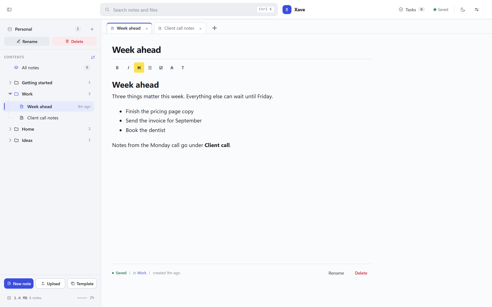
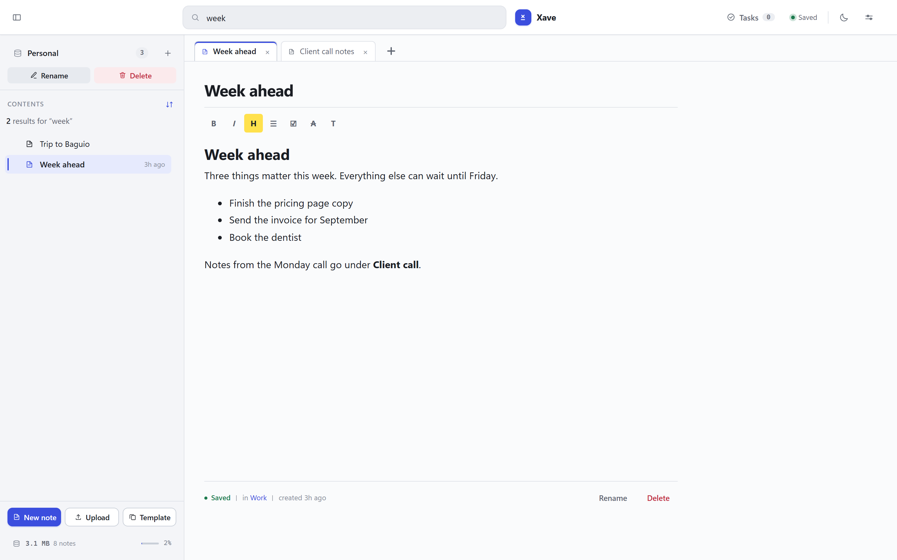
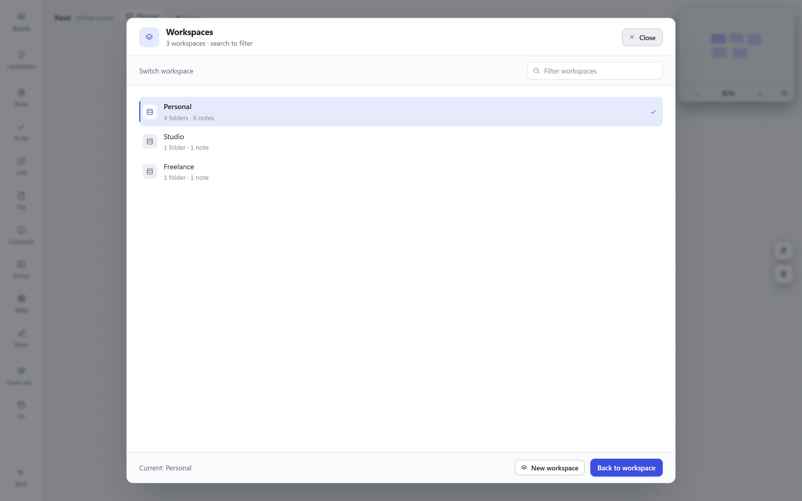
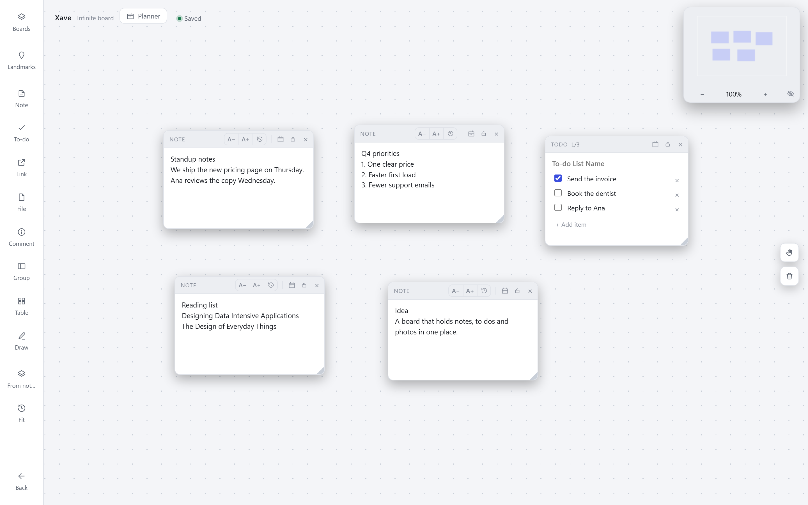
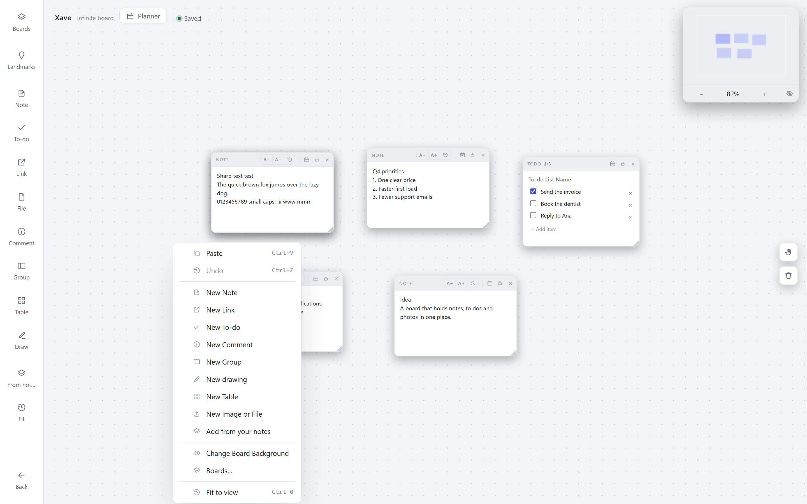
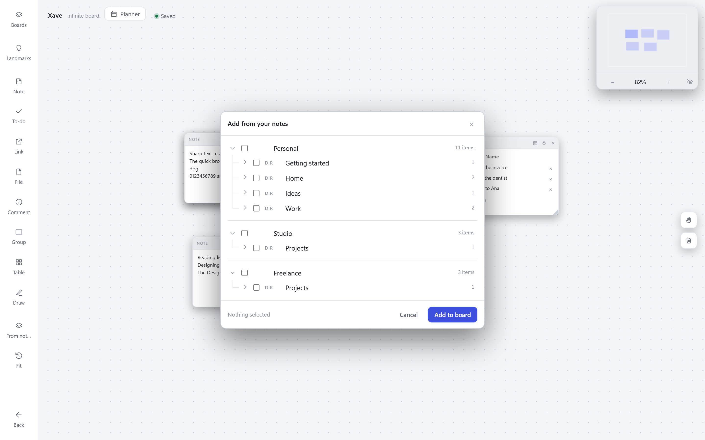
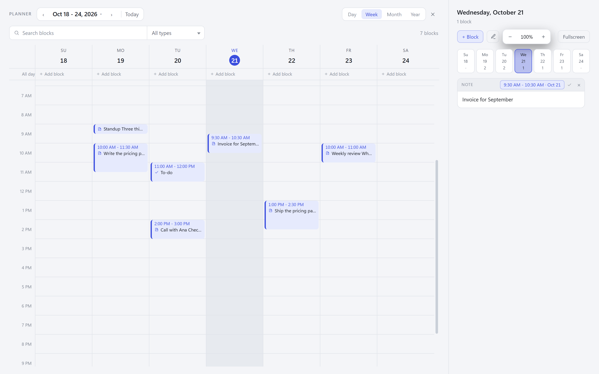
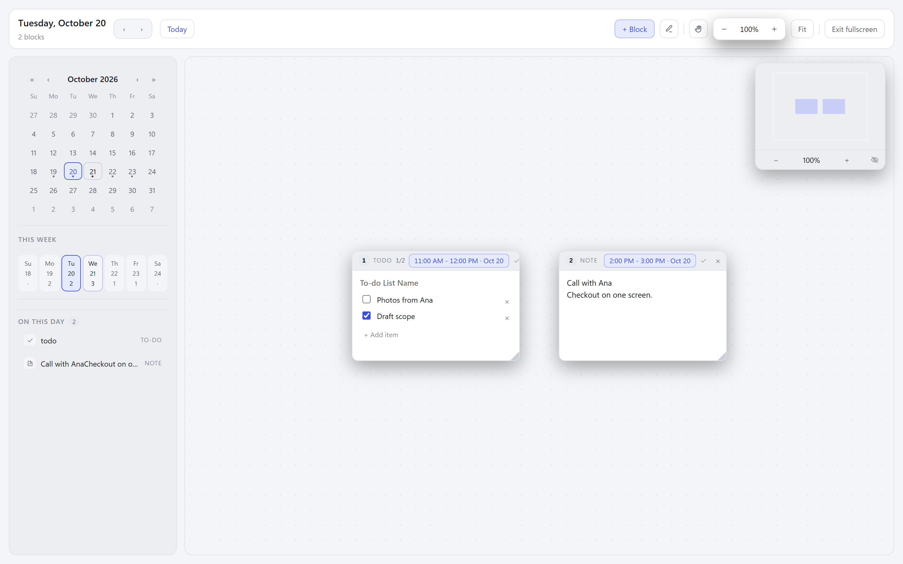
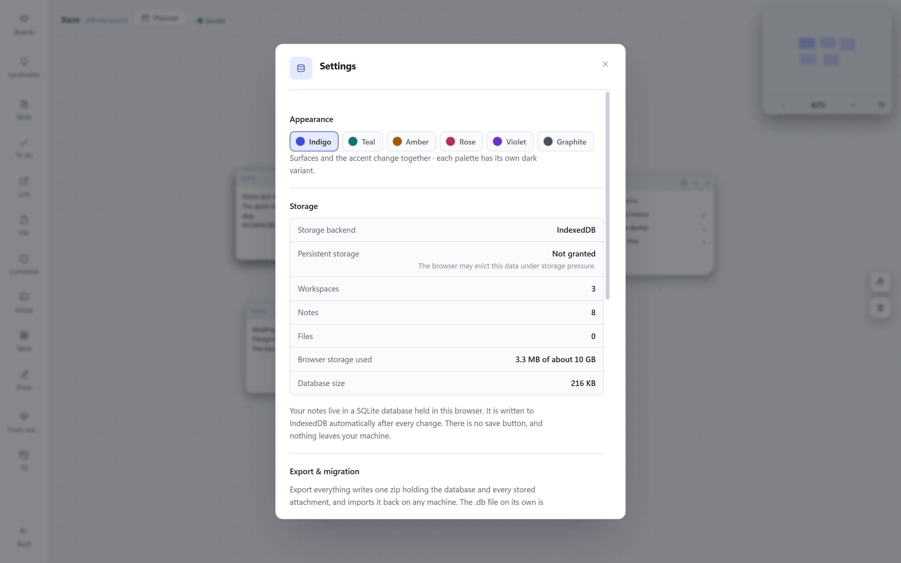
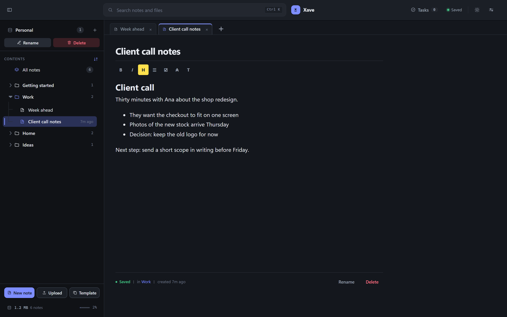

# Xave

A notebook, a board and a week planner that live in one file on your computer.
No account, no sign up, no internet needed.

## What this is

Xave is a small program you open in your browser. It keeps your notes in folders,
holds a pinboard of cards you can move around, and plans your week on a free canvas.
Everything you write is saved on your own computer, inside the browser. Nothing is
uploaded, and there is no account to create.

- One file, double click to open. Nothing to install.
- Works with no internet. Airplane mode is fine.
- Your notes never leave your computer.
- Free and open source.

## Everything it can do

**Writing**
- Folders, notes and uploaded files in one tree, with open tabs like a browser.
- Bold, italic, heading, highlight, list, checklist, quote, code and table from a small
  toolbar that stays out of the way.
- Notes link to each other, and each note shows the notes that link back to it.
- Everything saved as you type. There is no save button.
- Templates, so a note you like can become the starting point for the next one.

**Finding things again**
- One search box that covers every note, file and board: press **Ctrl K**.
- Deleted notes go to the trash and can come back.
- Separate workspaces, each with its own folders and notes, when one notebook is not
  enough. Search still reaches all of them.

**The board**
- A free canvas of cards: notes, to dos, links, photos, files, tables, drawings,
  groups of cards, and comment pins.
- Drag, resize, rotate, copy, group, and draw on the canvas with the pencil.
- Paste an image or drop files straight onto the board. Links become link cards.
- Zoom, pan, a small map in the corner, and **Fit** to bring everything back into view.
- Undo puts back the last thing you removed, photo and all.

**The planner**
- Day, week, month and year.
- Drop a note, a to do or a photo onto a day, then drag it where you want it and give
  it a time.
- Fullscreen mode turns a day into a free canvas, so a busy day can be laid out like a
  board instead of a list.
- Reminders and notifications for the things you must not forget.

**Making it yours**
- Six colour palettes, each with its own dark version.
- Text size, and a dark mode button in the corner.
- Installable: add it to your home screen and it opens like an app, offline.

## Write notes

Folders on the left, your note on the right. The toolbar above the text has bold,
italic, headings, lists, tickable checkboxes, tables and highlight. Notes can link to
each other, and the panel beside a note shows what links back to it.

The search box at the top covers notes, files and boards. Results appear in the left
panel while you type, and the note you had open stays where it was.

## More than one notebook

One workspace for personal things, one for work, one for a project that should not mix
with anything else. Each has its own folders and notes, and the switch is two clicks.

## Keep a board of cards

Press **Boards** in the left rail. A board is a free canvas: notes, to dos, links,
photos, files, drawings and comments, wherever you like. Drag them, resize them, group
them, draw on them. Press **Fit** to bring everything back into view.

Right click anywhere on a board for everything you can add, including anything you have
already written.

## Add from your notes

The best part of having everything in one place: press **Add from your notes** on a
board and pick from the same tree you write in. Folders, notes and files, placed on the
canvas as cards that still belong to the note they came from.

## Plan your week

Inside a board, press **Planner**. Add a block to a day, drag it to another hour, and it
stays where you put it. Day, week, month and year are at the top.

A single day can be opened fullscreen as a free canvas, with the same blocks laid out
the way you want them, the calendar still on the left, and the time on each block.

## Make it yours

The moon icon at the top right switches to dark mode. Settings, the sliders icon, has
colour themes, text size, your storage, and the backup buttons.

## Your notes stay on your computer

Everything is stored inside your browser, on this machine. Nothing is sent anywhere.
That also means:

- Clearing your browser data, or running a "clean up" tool, can delete your notes.
- A different browser, or a different computer, starts with an empty notebook.

Please make a backup now and then.

### Back up

1. Press the sliders icon at the top right to open **Settings**.
2. Press **Export everything**. One file is saved and it holds all of your notes.
3. Keep that file somewhere safe: another drive, a USB stick, or your cloud storage.

To come back later, or to move to another computer: open the app, **Settings**,
**Import a bundle**, then pick that file. **Export .db file** saves a copy that
database programs can read, which is useful for very long term storage.

## Open it (two minutes)

1. Near the top of this page, press the green **Code** button, then **Download ZIP**.
2. Unzip the folder anywhere you like, for example on your Desktop.
3. Double click **index.html**. It opens in your browser and is ready to use.

That is the whole setup. Keep the folder where it is. You can move it, copy it to a
USB stick, or keep a second copy on another computer.

> **First time?** The app opens with a short *Getting started* note that shows you
> around. Delete it whenever you like.

## Common questions

**Does it need internet?** No. Once the page is on your computer it works offline.

**Which browser?** Chrome, Edge, Firefox or Safari, recent versions. Chrome and Edge
are the smoothest.

**Do I need to install anything?** No. There is no installer and no account.

**Can I use it on my phone?** Yes. Put the folder on the phone and open index.html
with a file manager, or host it online (below) and add it to your home screen.

**Where are my notes kept?** Not inside index.html. Your browser stores them for this
page, so keep the file where it is and open that same file each time.

**Is my data private?** Yes. Nothing leaves your computer and there is no server.

**Are the screenshots real?** Yes. They are taken from the app itself, not drawn by
hand.

## Optional: put it online

If you want one link you can open from any device, publish the folder:

1. Put this folder in a GitHub repository.
2. Open the repository **Settings**, then **Pages**.
3. Choose **Deploy from a branch**, branch **main**, folder **/(root)**, then Save.
4. After a minute the app is at `https://<your name>.github.io/<repository>/`.

The page is public, but nobody sees your notes: each visitor gets an empty notebook
stored in their own browser.

## For developers

The readable source is in `src/`. `index.html` at the root is the built app that
everyone downloads, so rebuild it with `node tools/build.js` and commit it along with
your change. Architecture, storage details, test scripts and every command are in
[docs/DEVELOPERS.md](docs/DEVELOPERS.md).

## License

MIT.
